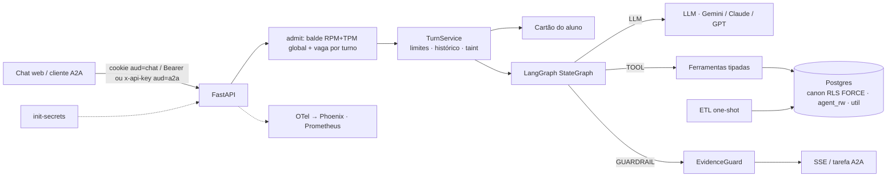
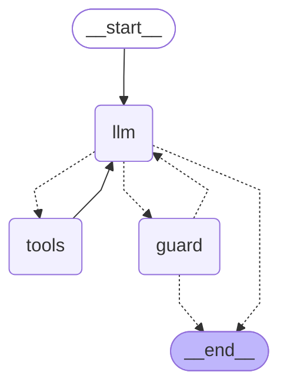

# Arquitetura do agente de atendimento ao aluno

Este documento explica o que foi decidido, por que, e o que custa. Vale para o escopo do case: um agente para o aluno **já autenticado**, sobre 5 marcas, 4 sistemas (SAG, LMS, secretaria, financeiro) e cerca de <!-- num:data.persons -->1000<!-- /num --> alunos, com data de referência 31/10/2026.

O agente consulta, explica e orienta sobre vida acadêmica, financeiro, protocolos, LMS e catálogo. Ele abre protocolos só como rascunho, que o próprio aluno confirma com um clique. Pelo A2A ele só consulta e orienta.

A tese que organiza tudo: **o que precisa ser garantido não pode depender do comportamento do modelo.** Isolamento entre alunos, ausência de dado corporativo, limites de capacidade e correção de valores são da arquitetura, testados sem LLM. O modelo é medido onde ele realmente decide: roteamento, redação e recusa.

## 1. Visão geral

Um turno funciona assim:

1. A API autentica o JWT (o canal define a audiência) e chama `admit()` **antes** de abrir o stream. Sem cota, o aluno recebe 429 ou 503 com `Retry-After`.
2. O `TurnService` monta a requisição ao modelo: prompt fixo, as 11 declarações de ferramenta fixas, e o **cartão do aluno** como resposta sintética de uma chamada `get_student_card`.
3. O grafo alterna `llm` e `tools`. Cada chamada de ferramenta abre uma conexão própria de banco, já com a identidade do aluno no RLS.
4. O texto gerado pelo modelo passa pelo EvidenceGuard. Reprovado, o modelo tenta mais uma vez com o feedback; reprovado de novo, as frases reprovadas são removidas (degradação por tipo) ou, se nada sobra, o texto vira um fallback montado a partir dos registros.
5. O mesmo `TurnService` atende o chat e o A2A: nenhum canal tem limites próprios.

## 2. As dez decisões centrais

Cada uma responde a uma pergunta da banca. As demais estão na seção 3.

### D1. Ferramentas tipadas sobre um modelo canônico

**Pergunta difícil:** por que não deixar o modelo escrever SQL, que seria mais flexível?

**Decisão.** O agente tem 11 ferramentas com parâmetros enumerados (`enrollment` é "1", "2" ou "3"; `status` e `kind` são enums). Nenhuma recebe identidade: quem fala é o `sub` do JWT, injetado no servidor. Cada ferramenta devolve registros tipados (`EntityRecord`) e valores já formatados (`R$ 1.234,56`, `dd/mm/aaaa`).

**Alternativas.** Text-to-SQL e um híbrido (ferramentas mais SQL livre para a cauda).

**Trade-off.** Perguntas fora do desenho das ferramentas não têm resposta, e o agente diz isso e oferece "Falar com a secretaria". Em troca, a superfície de ataque é enumerável: o teste do "LLM comprometido" exercita toda ferramenta com argumentos fuzzados, o que é inviável com SQL livre. Também fica determinístico o que importa para precisão: a regra de dívida, de elegibilidade e de prazo mora em código puro, testável contra um oráculo, e não numa conta que o modelo refaz a cada resposta. Uma pergunta comum custa 0 ou 1 ferramenta, o que mantém a latência na meta.

### D2. LangGraph chamando os SDKs dos provedores direto

**Pergunta difícil:** por que um grafo, e por que não um framework de agentes completo?

**Decisão.** Um `StateGraph` explícito com três nós (`llm`, `tools`, `guard`; a degradação é uma função do `guard`) que chama os SDKs do Gemini, Anthropic e OpenAI atrás de um contrato `LLMProvider`. Sem checkpointer: o histórico fica no Redis, com chave do servidor. Sem `interrupt()`: a confirmação humana acontece fora do grafo (D8).

**Alternativas.** Loop próprio; `AgentExecutor` do LangChain; `langchain-google-genai`.

**Trade-off.** O grafo dá um desenho publicável (`draw_mermaid`), `recursion_limit` (2·rodadas + 6) e eventos de progresso pelo stream writer. Ligar o SDK direto evita uma camada que esconderia `thought_signature`, contagem de tokens de cache e raciocínio, e timeouts por chamada, justamente o que a latência e o custo exigem. O raciocínio (assinatura do Gemini, blocos do Claude com `drop_block`, itens cifrados do GPT) volta só ao mesmo modelo. O contrato `LLMProvider` também permite os modos Scripted, Replay, Adversarial e LoadTest sem tocar no resto. O custo é manter três adaptadores (retry dos SDKs desligado; política comum em `app/agent/retry.py`).

### D3. Isolamento em camadas

**Pergunta difícil:** como garantir que um aluno nunca vê dado de outro, mesmo se o código errar ou o modelo for manipulado?

**Decisão.** Cinco camadas independentes:

- o ETL não carrega o que é interno; o destino é decidido **por coluna** (401 colunas, cada uma com destino, tipo e motivo);
- RLS forçado, roles sem superusuário e grants conferidos contra uma allowlist (`agent_app` sem TRUNCATE nem DELETE);
- `app.person_key` vem sempre do `sub` do JWT, nunca de argumento;
- nenhuma policy ou função de `agent_rw` referencia o schema `canon` (os helpers ficam em `util`), então a recarga do ETL não derruba a segurança;
- a API aborta na subida se a própria role tiver privilégio de superusuário ou de bypass.

**Alternativa.** Filtro por aluno na camada de aplicação.

**Trade-off.** RLS forçado complica a carga: antes do COPY o RLS bloquearia o dono, e depois do FORCE o dono lê 0 linhas. Por isso a carga roda numa transação que mede as contagens por SQL antes de aplicar `rls.sql`. O ganho é que um `WHERE` esquecido devolve zero linhas em vez de dados alheios.

### D6. EvidenceGuard determinístico

**Pergunta difícil:** como evitar que o agente invente um valor, uma data ou uma promessa, sem pagar um segundo LLM?

**Decisão.** Um verificador sem modelo que extrai afirmações do texto gerado e as ancora no **registro da entidade citada**. Ele confere valores, datas, períodos, percentuais e identificadores; status, polaridade ("não há débitos") e inteiros pequenos; ações por lema, inclusive no futuro ("vou abrir"); e compromissos (parcelamento, desconto, isenção), que só valem como promessa se a mesma condição vier de uma orientação de serviço ou de um acordo ativo. "Dívida", "saldo" e "débito" ancoram o valor no total para quitar, e não em qualquer número da evidência. Uma resposta curta ("sim, pode") herda as afirmações da pergunta. URL e tokens opacos são sempre bloqueados. O que o aluno escreveu só vale como evidência se foi argumento de uma ferramenta que devolveu registro. Uma ação só é aceita com um `SA-` vindo de nota do sistema, nunca digitado pelo aluno.

**Alternativas.** Só prompt; um LLM verificador.

**Trade-off.** É barato (sem chamada extra, sem ~1 s a mais) e auditável, mas tem limites declarados: um valor certo atribuído à entidade errada **quando a frase não cita entidade nenhuma** não é pego. Há risco de bloquear resposta correta, por isso o guard é medido nos dois sentidos: recall num conjunto de perturbação cego e bloqueio indevido nas rodadas reais. A degradação é por tipo, e o fallback é pelo domínio: uma pergunta de LMS nunca recebe o resumo financeiro.

**Integridade da medição cega.** Em 2026-11-04 um smoke do guard mediu o conjunto cego real (código em 3d67e20), divulgado sem o número; o oficial vem da rodada oficial e, com guard e semente iguais, reproduz o do smoke (divergência indicaria mudança no guard).

### D8. Escrita restrita

**Pergunta difícil:** o agente abre protocolos. Como impedir que um texto malicioso faça ele abrir o que não deve?

**Decisão.** O modelo nunca abre nada. Ele pode **preparar um rascunho** com `draft_protocol`, e só passam serviços de uma allowlist e que o aluno pode pedir (elegibilidade por regra: por exemplo, diploma só se formado e sem diploma emitido; revisão de nota e segunda chamada checadas por disciplina). O cartão do rascunho e o texto que o acompanha são montados pelo servidor; o rascunho fica no Redis preso ao aluno, com um `draft_id` (uuid4) que vai por um evento próprio do SSE e nunca é serializado para o modelo. A confirmação é um clique no chat web, que consome o `draft_id` uma vez (GETDEL), revalida serviço e elegibilidade, toma um `pg_advisory_xact_lock(hashtextextended(...))` calculado no SQL e faz um INSERT idempotente (`draft_id UNIQUE`). Se a conversa já teve texto livre de sistema (taint), `draft_protocol` é recusado na execução.

**Alternativas.** O modelo abre direto; `interrupt()` do LangGraph; confirmação pelo A2A.

**Trade-off.** O aluno dá um clique a mais e o agente não "resolve" sozinho. Pelo A2A não é possível garantir que quem confirma é uma pessoa, então a escrita simplesmente não existe nesse canal. O lock usa `hashtextextended` no SQL porque o `hash()` do Python muda a cada processo.

### D11. Avaliação com oráculo independente e holdout cego

**Pergunta difícil:** como saber que a resposta sai certa, e não apenas que os exemplos que escolhi saem certos?

**Decisão.**

- Um **oráculo** lê o CSV cru com a biblioteca padrão e não importa `core/`, `etl/` nem `app/`; ele só vale se cobre todos os protocolos e contas do LMS, e passa em dois autotestes (a resposta ideal passa; a ideal com um fato trocado reprova).
- O dataset tem pelo menos 50 templates de pergunta, e pelo menos 15 são `test_only`: escritos por um redator cego, que não vê prompt, ferramentas nem guard, e cifrados com `age` para a chave do autor.
- O **pré-registro** (hashes do dataset, do plano de análise e do código de pontuação, em `evals/golden/dataset.sha256`) é pensado para carimbo por OpenTimestamps (`make stamp`). O carimbo está pendente por decisão do autor, porque publica o hash em servidores externos; até lá, o commit do git é a única prova temporal (`evals/golden/analysis_plan.md`, seção 18).
- A métrica primária é o pass@1 do scorer determinístico na **primeira execução** no SHA congelado, com IC de 95% por bootstrap de dois fatores (aluno e template), estratificado pelas cotas. A meta é sobre o **limite inferior**.
- O scorer é validado: o autor rotula às cegas 30 respostas e o resultado vira VPP e VPN com Wilson. O pass@1 corrigido por isso é só análise de sensibilidade.
- Toda reprovação é atribuída pelo trace a um estágio (roteamento, dados, redação, guard bloqueou resposta certa, recusa indevida, gabarito).

**Alternativas.** Conversas escolhidas a dedo; LLM-juiz como métrica principal.

**Trade-off.** É caro e lento de montar, e a amostra é enriquecida por cotas (o que é declarado, e por isso o IC é estratificado). O juiz de qualidade roda só para medir concordância com o scorer, porque um juiz como métrica herdaria os vieses do próprio modelo. Números reais, quaisquer que sejam, vão para as evidências.

### D15. A2A 1.0 sobre o mesmo TurnService

**Pergunta difícil:** como oferecer o agente a outros agentes (por exemplo, Langflow ou ADK) sem abrir uma porta lateral para os limites e para os dados?

**Decisão.** Um servidor A2A 1.0 (JSON-RPC, sem modo de compatibilidade 0.3) sobre o `TurnService`, com Agent Card declarando só consulta e orientação. O `RedisTaskStore` guarda cada tarefa com o dono e um TTL, e filtra por dono em toda leitura. Push e streaming ficam desligados, e a mensagem tem uma única `TextPart`. Admissão recusada vira tarefa `REJECTED` com `metadata.retry_after_s`. O `contextId` é ligado ao dono: o de outro aluno cria uma conversa nova e vazia do próprio chamador.

O spike com o cliente real do SDK mostrou três fatos que moldaram o desenho:

- tarefa alheia em `GetTask`, `CancelTask` e `SendMessage` devolve `TaskNotFound` (<!-- num:a2a.TASK_NOT_FOUND -->-32001<!-- /num -->), e `ListTasks` de outro aluno devolve lista vazia;
- um `contextId` alheio é **aceito** pelo SDK, então o isolamento da conversa é do executor, e não do protocolo;
- uma exceção no executor, no TaskStore ou no context builder vira `InternalError(str(e))` com a mensagem original, e o SDK a registra. Por isso há wrappers com mensagem fixa, o executor captura tudo, o logger `a2a` é silenciado e a telemetria do SDK é desligada.

**Alternativa.** Só HTTP próprio.

**Trade-off.** O A2A é mais protocolo do que um endpoint simples, e o SDK tem arestas (o `GetExtendedAgentCard` com o card declarado devolve <!-- num:a2a.GetExtendedAgentCard_com_extended_agent_card_False -->-32004<!-- /num -->, e não o <!-- num:a2a.EXTENDED_CARD_NOT_CONFIGURED -->-32007<!-- /num --> que a leitura da especificação sugeria). Em troca, os 11 métodos têm teste de posse (`tests/e2e/test_a2a.py`). A demonstração é `make a2a-demo`; o consumo por Langflow ou ADK é desenho, não demonstrado.

### D16. Observabilidade que liga qualidade e operação

**Pergunta difícil:** quando uma resposta sai errada, como descobrir por quê sem gravar a conversa do aluno?

**Decisão.** Um trace por turno (AGENT, LLM, TOOL, GUARDRAIL) com atributos OpenInference e `gen_ai.*`, inclusive tokens de cache e de raciocínio. Os spans carregam argumentos **enumerados** das ferramentas e contagens, **sem conteúdo**; o conteúdo só existe nos perfis de desenvolvimento e avaliação, com dados sintéticos. O `session.id` é um HMAC da conversa. O runner da avaliação e o botão de feedback gravam anotações no Phoenix por `trace_id`, e a causa do erro vira o rótulo da anotação. Em produção, quando o aluno marca 👎, só as **saídas tipadas** do turno vão para `agent_rw.turn_output` por 7 dias, com RLS, para investigação por uma role de auditoria (`make investigate`). Prometheus traz sinais de qualidade sem gabarito: tipo de resposta por domínio e funil do rascunho.

**Alternativa.** Só logs.

**Trade-off.** Sem conteúdo, depurar um caso exige reconstruir a resposta a partir das saídas tipadas e dos kinds do guard, o que é mais trabalhoso do que ler a conversa. É o preço de não guardar PII. O spike do Phoenix mostrou duas armadilhas já tratadas: a autenticação ligada por padrão fora do loopback, e o `force_flush`, que roda em thread com timeout.

### D17. Capacidade e custo

**Pergunta difícil:** "escalável" significa o quê, quando o gargalo real é a cota do modelo?

**Decisão.** O `TurnService.admit()` roda **antes** do stream e reserva a estimativa de requisições e de tokens num balde RPM+TPM global (script Lua no Redis), dimensionado a 90% da cota, mais uma **vaga por turno**, como lease com TTL. O `settle()` roda sempre, em `finally` sob `asyncio.shield`, inclusive se o cliente cair antes do primeiro byte. Sem cota, HTTP 503 com `Retry-After`. O deadline do turno é propagado e o timeout de cada chamada é o deadline restante. Retry só em 429 e 5xx, com tempo de sobra, teto de 10% das chamadas. Há orçamento diário por aluno e teto global de gasto: a 80%, o perfil padrão reduz as rodadas e dispensa o retry do guard; a 100%, devolve 503. A conexão de banco é por chamada de ferramenta, e o histórico é compactado.

**Alternativa.** Ilimitado.

**Trade-off.** Recusar cedo, com `Retry-After`, é pior para o aluno do que enfileirar, mas enfileirar estoura o deadline. O limitador **nunca** corta um turno no meio. A conta de capacidade está na seção 8.

### D21. Cartão do aluno como chamada sintética de ferramenta

**Pergunta difícil:** como responder a maior parte das perguntas com uma única chamada ao modelo, mantendo o cache do prefixo?

**Decisão.** Um resumo do aluno de até 400 tokens (estimados; `tests/integration/test_card.py`), sem nome, é entregue como `functionResponse` de uma chamada sintética a `get_student_card`. Traz matrículas, total para quitar, próximo vencimento, protocolos abertos, próxima avaliação e cobertura de dados. O prompt de sistema e as 11 declarações de ferramenta são idênticos para todos os alunos, então o cache implícito do provedor é preservado.

**Alternativas.** Só ferramentas (uma chamada a mais em toda pergunta); cartão como texto da mensagem do usuário.

**Trade-off.** Um `functionResponse` não pode ser forjado pelo aluno, que um texto de usuário poderia imitar. O custo é que o provedor pode exigir a declaração da função sintética e a assinatura de pensamento; isso é checado no portão do primeiro dia (**pendente: teste live com chave**). Se exigido, a função entra sem parâmetros e devolve o mesmo cartão.

## 3. Decisões menores

O motivo de não serem centrais: ou são consequência direta de uma central, ou a alternativa não era plausível.

| # | Decisão | Alternativa | Por que não é central |
|---|---|---|---|
| D4 | Ontologia em YAML: destino e tipo das 401 colunas, rótulos PT, listas exatas, léxicos do guard | Allowlists espalhadas | Consequência de D3 e D9: é a fonte única de testes e documentação |
| D5 | Sem RAG vetorial: o catálogo pequeno vai inteiro, em PT | pgvector, `pg_trgm` | Não há texto não estruturado para recuperar |
| D7 | Sem classificador de jailbreak | Classificador | Probabilístico e custa cerca de 1 s; a avaliação mede o comportamento |
| D9 | Texto tipificado no ETL: provas, salas e mensagens viram tipos conhecidos; o resto é `texto_livre` e nunca vai ao LLM | Marcar tudo como não confiável | É o mecanismo de D3 contra injeção indireta; entra no taint |
| D10 | SSE com progresso, resposta já checada e heartbeat; cancelamento ao desconectar | Streaming de tokens | O guard precisa do texto inteiro |
| D12 | Toda chave Redis é uma `RKey` criada só por `rkey(kind, scope, channel, id)`; mypy estrito em `app/` | Strings livres | Higiene verificada por tipo e por teste |
| D13 | JWT HS256 com algoritmo fixo e `aud` por canal | Identidade no corpo | Padrão; em produção, token exchange (RFC 8693) |
| D14 | `person_key` = HMAC-SHA256(segredo, CPF) | UUIDv5 | UUIDv5 é reversível por quem conhece o CPF |
| D18 | AI Studio ou Vertex, com o mesmo código | Só um | Portabilidade |
| D19 | `LLM_PROVIDER=auto`: sem chave, replay roteirizado que chama as ferramentas de verdade (`app/agent/replay.py`) | Exigir chave | Quem avalia roda sem chave (modo local/dev). `app_env=prod` exige um provedor real com chave e limites default; `replay`, `fake`, `loadtest` e `auto` sem chave são recusados na subida |
| D20 | Só `core/clock.py` lê relógio | Relógio livre | Respostas iguais depois de 10/11; testado por regex |
| D22 | `enrollment` é um enum estável "1", "2" ou "3" | Rótulos por aluno | Cache e escopo |
| D23 | `init-secrets` gera todos os segredos, um volume por consumidor, lidos só de arquivo | `.env` de exemplo | Segredo público permite forjar JWT |
| D24 | Cobertura por tipo de dado, derivada pelo ETL | Responder 0 | "Zero" é diferente de "sem dados": o agente diz "não há dados antes de dd/mm/aaaa" |
| D25 | `TurnService` comum ao SSE e ao A2A | Controles na rota | Já está dentro de D15 e D17 |

## 4. Grafo do agente

Pontos que o diagrama não mostra:

- O diagrama é a saída de `draw_mermaid()` (`docs/evidence/graph.md`). O nó `tools` recria o `ToolContext` a cada rodada, e o `tainted` é recalculado; aplica `Tool.allowed` e registra um `ToolCallTrace` por chamada. O laço `llm` e `tools` vai até `max_rounds` (4; 2 sob custo); a última rodada e o retry do guard vão sem ferramentas.
- Se a rodada emitiu um rascunho, o turno faz sempre mais uma chamada, com as ferramentas ainda declaradas, e a instrução "responda só ao resto da mensagem, ou nada". A resposta final é o texto fixo do servidor mais o resto, e **só o resto** passa pelo guard.
- O guard confere apenas texto gerado pelo modelo. Textos do servidor (rascunho, "Solicitação SA-… aberta", fallback, recusas fixas) ficam fora.

## 5. Dados

### 5.1 Princípios

As fontes da verdade são: SAG para status e notas; faturas e encargos para dívida (o `receivable_snapshot` serve só de gabarito externo); secretaria para protocolos; LMS para atividade, sempre apresentada como nota "não oficial". "Hoje" vem de `reference_today()` e instantes sem fuso do SAG são tratados como America/Sao_Paulo.

O ETL recria o schema `canon` a cada carga, numa transação: cria as tabelas, faz COPY, **compara contagens SQL com as contagens em memória**, gera o relatório e só então aplica o RLS. O schema `agent_rw` é persistente e não tem FK para `canon`: a integridade é checada na aplicação, porque `DROP SCHEMA canon CASCADE` derrubaria a FK e a policy.

### 5.2 Resolução de entidades

Os quatro sistemas não compartilham chave. A resolução foi verificada nos CSV e contra um oráculo independente:

- **Pessoa:** pelo CPF. O `PERSON_ID` não serve: 15 CPFs têm dois (`docs/research/2026-11-03-perfil-dos-dados.md`).
- **Matrícula:** (marca, RA) com dígito verificador mod 11. Nunca só o RA, porque há 173 RAs repetidos em 2 a 5 marcas EAD (mesma fonte).
- **LMS:** SSO por tenant e padrão `PRES_nnnnn` ou `EAD_nnnnn`, mais as contas manuais ligadas por `user_loggedin`. Resultado: <!-- num:data.lms_accounts -->1003<!-- /num --> contas. Contas de professor, administração, integração e `aluno.teste*` não entram em contagem nenhuma.
- **Financeiro:** pelo contrato da matrícula (<!-- num:data.contracts -->1065<!-- /num --> contratos resolvidos), nunca por `taxId` nem `customerId`.
- **Secretaria:** cinco regras em ordem de confiança.

| Regra de ligação do protocolo | Protocolos |
|---|---|
| `ra_cpf` | <!-- num:data.rule.ra_cpf -->3455<!-- /num --> |
| `guardian_payer` (Stu_ID válido, solicitante pagador) | <!-- num:data.rule.guardian_payer -->73<!-- /num --> |
| `guardian_payer_unique` (sem Stu_ID, o responsável paga uma única matrícula na marca) | <!-- num:data.rule.guardian_payer_unique -->29<!-- /num --> |
| `cpf_brand_unique` | <!-- num:data.rule.cpf_brand_unique -->337<!-- /num --> |
| `cpf_brand_by_date` | <!-- num:data.rule.cpf_brand_by_date -->17<!-- /num --> |
| **Ligados** | <!-- num:data.protocols_linked -->3911<!-- /num --> |
| **Sem vínculo** | <!-- num:data.protocols_unlinked -->22<!-- /num --> |

O invariante conferido é que o solicitante é o aluno ou um pagador do contrato. As referências cruzadas do SAG para a secretaria (`PROTOCOL_REF`) batem <!-- num:data.protocol_ref -->229<!-- /num --> de <!-- num:data.protocol_ref -->229<!-- /num -->, e o snapshot financeiro confere <!-- num:data.snapshot -->273<!-- /num --> de <!-- num:data.snapshot -->273<!-- /num -->. Na carga, as contagens SQL e em memória são iguais em todas as tabelas, e os <!-- num:data.logins_absent -->29<!-- /num --> logins de analista que existem nos dados de origem estão ausentes de toda tabela carregada.

### 5.3 Escolhas de precisão

**Na dúvida, não liga.** Há casos que outro sinal resolveria, mas que ficam sem vínculo de propósito: dois `Stu_ID` com erro de digitação, e responsáveis que pagam duas matrículas e abrem protocolo sem dizer de qual. Ligar errado mostraria o protocolo de uma pessoa a outra; não ligar só o esconde. Os <!-- num:data.protocols_unlinked -->22<!-- /num --> protocolos sem vínculo são o custo declarado dessa escolha.

Outra escolha: **o agente não recalcula nota nem média.** Mostra a nota armazenada. Quando a frequência contradiz o resultado (reprovado por falta com frequência acima do mínimo), a ferramenta sinaliza a divergência, o agente mostra os dois valores, diz qual é o oficial e oferece revisão.

### 5.4 O que nunca é carregado

Dados pessoais de qualquer pessoa (CPF, nascimento, filiação, contato, endereço), inclusive de pagador e de responsável; analistas e seus logins; professor além do nome de uma lista exata congelada; notas internas e mensagens de solicitante; prioridade, SLA violado e pesquisas de satisfação; impostos, estágio de cobrança, referência de transação, banco e CNPJ; IP, URL e `relateduserid` do LMS; contas que não são de aluno.

### 5.5 Texto livre e injeção indireta

Texto escrito por humanos nos sistemas de origem é o canal natural de injeção indireta. O ETL o trata assim: nomes de prova, salas e mensagens de atendimento viram tipos conhecidos (AV1, AV2, simulado; a disciplina em PT; um dos 4 modelos de mensagem). Mensagens de solicitante ficam de fora. O que sobra é `texto_livre` e **nunca chega ao LLM**: a ferramenta devolve o placeholder "[mensagem não exibida]". Mesmo assim, a conversa que viu um `texto_livre` fica contaminada até o fim (taint fixo), e `draft_protocol` passa a ser recusado. O taint só dispara com texto plantado, então a injeção indireta fica sem canal até o modelo.

### 5.6 Regras de negócio relevantes

- **Dívida:** saldo da fatura = líquido menos principal confirmado, só para faturas abertas, vencidas ou parciais. Encargos em aberto = encargos não dispensados menos o que já foi pago. O total para quitar soma principal vencido e encargos. Fatura renegociada fica de fora, substituída pelas parcelas do acordo.
- **Simulado aberto:** janela aberta e **sem tentativa** (<!-- num:data.simulados_abertos -->1217<!-- /num --> na data de referência). Os que ainda têm tentativa restante (<!-- num:data.simulados_restantes -->1615<!-- /num -->) são reportados à parte. Provas que valem nota e encerraram sem tentativa: <!-- num:data.provas_sem_tentativa -->0<!-- /num -->.
- **Cobertura:** cada fonte começa numa data (eventos de matrícula, notas, secretaria, LMS, financeiro). Fora da janela, a resposta é "não há dados antes de dd/mm/aaaa", nunca zero.

## 6. Segurança

A pergunta de projeto é se a segurança sobrevive a um modelo comprometido. Por isso há duas classes de prova: **testes de arquitetura**, que não usam o LLM, e **ataques com LLM real**, que medem comportamento.

| Ameaça | Defesa de arquitetura | Prova |
|---|---|---|
| Falsificar identidade | JWT HS256 com algoritmo fixo e `aud` por canal | Testes de token adulterado, expirado, `alg=none`, troca de algoritmo e de `aud` |
| Segredo exposto | `init-secrets`, um volume por consumidor, leitura só de arquivo | A API sobe sem `/data` e sem os segredos do ETL |
| Vazamento entre alunos | Ferramentas sem identidade, enum de índice, RLS forçado, grants por allowlist, reset do pool, `RKey` | Teste do **LLM comprometido**; IDOR por recurso e nos 11 métodos A2A; `contextId` alheio |
| Vazamento corporativo | Destino por coluna no ETL; catálogo por família | Varredura por valor do dump de `canon` (CPF, e-mail, telefone, IP, referência de transação, CNPJ, nome de não-aluno); os logins de analista ausentes |
| Injeção indireta | `texto_livre` nunca ao LLM; texto tipificado; taint fixo | Marcador plantado em **toda** célula de texto dos 47 CSV, passado pelo ETL e por um LLM comprometido: nenhum marcador em saída confiável |
| Excesso de autonomia | Allowlist, elegibilidade, cartão do servidor, `draft_id` preso ao aluno e fora do LLM, uso único, clique humano, lock | Confirmação concorrente; dois rascunhos concorrentes; `draft_id` alheio; `SA-` digitado pelo aluno |
| Falsa promessa | Guard ancorado no registro, compromisso exige fonte | Testes do guard com controles positivos |
| Exceção vazando pelo A2A | Wrappers, executor que captura tudo, logger e telemetria do SDK desligados | Um `RuntimeError` com URL de banco não aparece na resposta, nos logs nem nos spans |
| Chave Redis montada à mão | `RKey` e `RKind`, mypy em `app/` | Teste que proíbe `RKey(` fora de `core/rkey.py` |
| Consumo abusivo | Admissão a 90% da cota, vaga por turno, rate limit, orçamento, teto | Testes, inclusive via A2A, e a escada de carga com cota simulada |
| CSRF e saída | SameSite=Strict; mesma origem (`Origin` × `Host`) e JSON em `POST /chat`, `/protocols/confirm` e `/feedback`; A2A só com Bearer; CSP, `nosniff`, texto puro | Testes |
| Entrada abusiva | `contextId` e `taskId` do A2A em `^[A-Za-z0-9_-]{1,64}$` (regra do web); corpo até 64 KiB (413) | Testes |

**Ataques com LLM real.** São 15 categorias: jailbreak, roleplay, quebra de papel, falsa promessa, extração de prompt literal e por paráfrase, sequestro de rascunho e escalada multi-turno (comportamento); identidade, outro aluno, outra marca, funcionários e credenciais (vazamento); injeção plantada e armazenada (zero por construção, conferido pelo teste do marcador). O número primário é a suíte completa de desenvolvimento, com 2 repetições, rodada **antes** de qualquer correção, mais uma rodada de holdout cego e adaptativo no SHA congelado, em que um redator cego escreve os templates sem ver o código e um LLM atacante os refina em até 3 tentativas. A unidade do intervalo de Wilson é o **template de ataque**: ele falha se qualquer mutação ou repetição falhar.

Resultado, quando existir: ataques de comportamento bem-sucedidos (desenvolvimento) <!-- num:security.dev.behavior.success -->a medir<!-- /num -->; no holdout <!-- num:security.holdout.behavior.success -->a medir<!-- /num -->; vazamentos <!-- num:security.leak.success -->a medir<!-- /num -->.

## 7. Qualidade

O método está em D11. Aqui ficam os resultados e o que eles não dizem. Nada desta seção foi medido ainda (sem chave de LLM); os marcadores abaixo mostram "a medir".

| Medida | Desenvolvimento | Teste |
|---|---|---|
| pass@1 primário (IC 95%) | <!-- num:quality.dev.pass1 -->a medir<!-- /num --> | <!-- num:quality.test.pass1 -->a medir<!-- /num --> |
| Templates vistos | <!-- num:quality.seen.pass1 -->a medir<!-- /num --> | |
| Templates não vistos (`test_only`) | | <!-- num:quality.unseen.pass1 -->a medir<!-- /num --> |
| Recusa correta | | <!-- num:quality.test.refusal_ok -->a medir<!-- /num --> |
| Recusa indevida | | <!-- num:quality.test.refusal_wrong -->a medir<!-- /num --> |
| Perguntas que cruzam sistemas | | <!-- num:quality.test.cross -->a medir<!-- /num --> |
| Bloqueio indevido do guard | | <!-- num:guard.false_block -->a medir<!-- /num --> |
| Recall do guard (perturbação cega) | | <!-- num:guard.blind_recall -->a medir<!-- /num --> |

A meta é um limite inferior de 85% no pass@1 primário. Meta é compromisso, não resultado: abaixo dela, o número é publicado como está, com a análise de erro por causa.

O que esta avaliação **não** garante: a amostra é de 40 alunos de teste com cotas (enriquecida em casos raros, o que o IC estratificado reconhece mas não elimina); o scorer foi validado com 30 respostas, então o pass@1 corrigido é sensibilidade, não o resultado; e o holdout só é cego para quem não viu o código, não para o autor. O gabarito de algumas áreas (acadêmico e LMS) não tem fonte externa, e por isso 20 itens sorteados são conferidos à mão.

## 8. Latência, capacidade e custo

**Latência** é medida por classe de turno: `card` (nenhuma ferramenta, caminho nominal de uma chamada), `1` (uma ferramenta) e `2+`. As metas vêm de uma fórmula registrada antes das medições: uma lognormal por componente (chamada que emite ferramenta, chamada que responde e overhead, que reúne SQL, guard e infraestrutura), com Monte Carlo por classe e modelo, **incluindo o retry do guard no sorteio**, aplicada a todos os quantis e ao tempo até o primeiro evento (TTFE). A meta de cada quantil é o maior valor entre a meta inicial e a prevista. A fórmula é atualizada uma única vez, depois da primeira rodada de desenvolvimento, e congelada. A fonte única dos números é `slo_targets.yaml`.

Dois trade-offs: o TTFE da classe `card` é igual à latência total, porque o guard precisa do texto inteiro antes de qualquer byte da resposta. E o orçamento do grafo é derivado (p99 previsto da classe `2+` vezes 1,2), de modo que uma chamada nunca ultrapassa o que o turno ainda tem.

Hoje a fórmula roda com **priors**, não amostras: o portão do LLM depende de chave e ainda não foi executado. Os priors são do Gemini; com outro modelo, a janela A reajusta para ele, dito com os números. Janelas: A (rodada de desenvolvimento, a única que reajusta a fórmula), B e C (esta, no SHA congelado); as tabelas ficam vazias até lá.

| Classe | p50 | p95 | TTFE p95 |
|---|---|---|---|
| `card` | <!-- num:latency.card.p50 -->a medir<!-- /num --> | <!-- num:latency.card.p95 -->a medir<!-- /num --> | <!-- num:latency.card.ttfe_p95 -->a medir<!-- /num --> |
| `1` | <!-- num:latency.one.p50 -->a medir<!-- /num --> | <!-- num:latency.one.p95 -->a medir<!-- /num --> | <!-- num:latency.one.ttfe_p95 -->a medir<!-- /num --> |
| `2+` | <!-- num:latency.two_plus.p50 -->a medir<!-- /num --> | <!-- num:latency.two_plus.p95 -->a medir<!-- /num --> | <!-- num:latency.two_plus.ttfe_p95 -->a medir<!-- /num --> |

Overhead de infraestrutura (tudo que não é modelo): <!-- num:latency.overhead.p95 -->a medir<!-- /num -->. Turnos que estouraram o orçamento do grafo na janela A: <!-- num:latency.budget_exceeded -->a medir<!-- /num -->.

**Capacidade.** "Milhares simultâneos" vira alunos ativos, mensagens por minuto, RPM e TPM contra a cota do modelo, e só depois réplicas, pela CPU por turno. O TPM limita antes da CPU. Vagas de turno e pool de conexões são dimensionados pela lei de Little. A carga é gerada por um `LoadTestLLM` com latências sorteadas das lognormais do portão, em duas escadas de laço aberto contra a API: (a) com o limitador ligado e uma cota simulada derivada das vagas (platô de goodput, 503 com `Retry-After`, retries e cortes dentro de um teto, e o motivo da rejeição por degrau: cota ou vagas) e (b) sem limitador, para achar o joelho e a CPU por turno. Resultado: <!-- num:latency.load.plateau -->a medir<!-- /num -->.

**Custo.** Medido por turno, por índice de turno e por aluno ao mês, com tokens de entrada, saída, raciocínio e cache. Custo médio por turno: <!-- num:latency.cost.per_turn -->a medir<!-- /num -->. O relatório informa a tabela de preços usada.

Há duas alavancas, desligadas por padrão: o hedge da primeira chamada no p90 e a comparação entre os dois modelos por classe. O hedge vive no `TurnService` (`hedger`, flag `lever_hedge_first_call`), tem orçamento (10% das chamadas por minuto, com piso) e só dispara com o balde de admissão abaixo de 80%; a segunda requisição é contabilizada no balde, na cota diária e no gasto. O streaming por frase foi removido: o guard precisa da resposta inteira. Os resultados vão para `docs/evidence/latency.md` sem alterar o padrão.

## 9. Observabilidade

A decisão está em D16. Em operação:

- **Logs** em JSON com `trace_id`, sem PII. Exceção só pelo tipo.
- **Spans:** `chat.turn` (AGENT, aberto antes do evento `meta`) contém `agent.call_model` (LLM), `agent.tool` (TOOL, com `db.query`) e `agent.guard` (GUARDRAIL, com desfecho e kinds). Atributos de modelo, tokens (com cache e raciocínio) e hashes do prompt, das ferramentas e do dataset.
- **Métricas** Prometheus em modo multiprocesso, com buckets vindos de `slo_targets.yaml`: turnos, latência, TTFE, erros e retries de LLM, admissão, vagas, guard, tipo de resposta, funil do rascunho, tokens, custo e feedback.
- **SLO:** latência e TTFE por classe, custo por dia e qualidade (degradado mais fallback, 👎, recusa e vazio por domínio). Status `degraded` e `fallback` contam como disponíveis, mas entram no SLO de qualidade. O alerta fica proposto, não implantado.
- **Phoenix** com volume persistente; a rodada de teste é exportada para `docs/evidence/phoenix/`, para ver os traces sem subir nada.

## 10. Integração em produção

Esta seção descreve o caminho, não algo já feito. Fora do escopo: deploy em nuvem, atendimento a responsável, escrita via A2A, auditoria persistente de conversas e streaming A2A.

- **Dados:** hoje o ETL carrega CSV numa carga única. Em produção, a entrada seria CDC dos bancos de origem ou APIs dos sistemas, com o mesmo contrato por coluna e as mesmas verificações de contagem. A escrita do rascunho confirmado sairia por **outbox**, na mesma transação do INSERT, para um worker que abre o protocolo no sistema da secretaria com retry idempotente por `draft_id`.
- **Identidade:** o JWT de desenvolvimento dá lugar a um provedor de identidade da instituição. O A2A usaria **token exchange (RFC 8693)**: o agente chamador troca o token do aluno por um token de audiência `a2a` com claim `act`, de modo que o `sub` continua sendo o aluno e o chamador fica registrado.
- **Modelo:** Vertex AI com cota provisionada, com o mesmo código (`llm_backend`, projeto e região) e a conta de serviço montada somente leitura. O balde de admissão passa a ser dimensionado pela cota contratada.
- **Orquestradores:** é desenho, não está demonstrado: Langflow e ADK consumiriam o agente pelo A2A. O componente de A2A do Langflow envia a chave em `x-api-key`, e por isso o servidor aceita os dois esquemas (`test_x_api_key_works`). A integração entregue é o cliente de `make a2a-demo`; a raia do Langflow não foi entregue.
- **Escala:** réplicas sem estado atrás de um balanceador; o estado é Redis (histórico, admissão, tarefas A2A) e Postgres. A CPU por turno medida na escada de carga define quantas réplicas por RPM.

## 11. Limites honestos

<!-- autor: acrescentar aqui os "limites conhecidos" registrados no sábado, depois do congelamento -->

- Limites de segurança conhecidos: a pilha de avaliação local compartilha banco, Redis e o segredo do JWT com a API; o `init-secrets` monta o repositório só-leitura como root; `/metrics` e o Phoenix não têm autenticação (só em 127.0.0.1); o JWT não tem `iss`; o teto de corpo olha só o `Content-Length`.
- O guard não pega um valor correto atribuído à entidade errada quando a frase não cita nenhuma entidade.
- Os <!-- num:data.protocols_unlinked -->22<!-- /num --> protocolos sem vínculo (ver 5.3) não aparecem para nenhum aluno, por escolha de precisão.
- A regra de média e aprovação não existe nos dados, e o agente diz isso em vez de inferir.
- Trancamento, cancelamento, transferência e migração são só orientação: o agente explica e oferece "Falar com a secretaria".
- Sem classificador de jailbreak: a defesa é a arquitetura, e o comportamento do modelo é medido, não garantido.
- A latência depende da cota e do provedor no dia da medição; os números valem para as janelas descritas.
- Com a data de referência fixa em 31/10/2026, o agente não representa o "hoje" real; é uma escolha para que a banca receba as mesmas respostas depois do prazo.
- **Pendente: sem chave de LLM.** O portão de latência, o cache do prefixo, a chamada sintética do cartão e as cotas ainda não foram medidos. Nada nas seções 7 e 8 é resultado.

## 12. Como foi construído

<!-- autor: escolha da opção (a) de transparência. Se for (a), descomente a proposta abaixo; se não, deixe a seção vazia ou remova-a.
Proposta (factual, até 8 linhas):
O projeto foi feito em etapas: especificação, plano de tarefas e implementação tarefa a tarefa, cada uma com teste antes do código. A implementação foi delegada a agentes de IA, e cada tarefa foi revisada por uma revisão independente antes de entrar. Do autor: as decisões de arquitetura e escopo; a verificação dos dados contra os CSV de origem; a rotulagem às cegas de 30 respostas para validar o scorer; a conferência manual de 20 itens do gabarito; e a curadoria das evidências. Os números são gerados por script a partir dos arquivos de evidência, e nenhum é digitado à mão.
-->

## Apêndice. Estatística

- **Bootstrap de dois fatores.** O pass@1 é calculado sobre pares (aluno, template). O intervalo reamostra alunos e templates, estratificado pelas cotas, porque respostas do mesmo aluno ou do mesmo template não são independentes.
- **P(meta).** A correlação intraclasse é estimada no desenvolvimento, e a probabilidade de o limite inferior passar de 85% é simulada e registrada antes da rodada de teste.
- **Wilson.** Usado para proporções com poucos casos: VPP e VPN do scorer e os ataques por template.
- **Correção pelo scorer.** O pass@1 corrigido é p̂·VPP + (1 − p̂)(1 − VPN), com intervalo por bootstrap combinado com Beta. É análise de sensibilidade; o primário é o que rodou.
- **Escolha de modelo.** Pela primeira rodada de desenvolvimento, com margem pareada de pelo menos 3 pontos percentuais; abaixo disso, o mais barato.
- **Unidade do ataque.** Um template de ataque falha se qualquer mutação ou repetição falhar.

<!-- chaves esperadas (render_docs.py falha se faltar alguma):
data.*, a2a.*: já existem (data-quality.json, spikes.json).
quality.dev.pass1, quality.test.pass1, quality.seen.pass1, quality.unseen.pass1,
quality.test.refusal_ok, quality.test.refusal_wrong, quality.test.cross
guard.false_block, guard.blind_recall
security.dev.behavior.success, security.holdout.behavior.success, security.leak.success
latency.card.p50, latency.card.p95, latency.card.ttfe_p95, latency.one.*, latency.two_plus.* (mesmos três),
latency.overhead.p95, latency.budget_exceeded, latency.load.plateau, latency.cost.per_turn
Origem de cada chave: docstring de `build_numbers` em scripts/render_docs.py. -->
