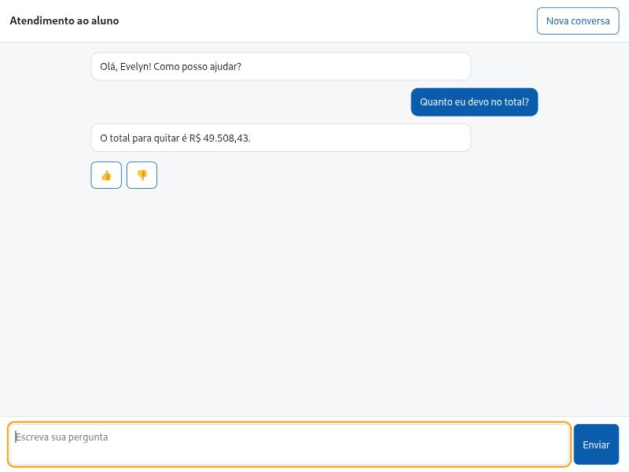

# Evidências

Cada arquivo de evidência é gerado por script, com um `.json` de números e um `.md` legível (os que ainda não existem estão marcados "A gerar"). Modelo sob teste: `claude-haiku-5-5`. Rodadas reais já publicadas: dev 1 a 3, guard, ataques e janela A de latência. Teste cego, janelas B e C e carga: a medir. Os números de `README.md` e de `docs/ARCHITECTURE.md` vêm desses JSONs por `scripts/render_docs.py` (que também grava `numbers.json`); nenhum é digitado à mão. Os resultados de avaliação são publicados como saíram, inclusive quando ficam abaixo da meta. `make publish-evidence` copia as saídas públicas dos runners (security, latência, escada a) do volume para esta pasta; `python scripts/render_docs.py` renderiza os números (o guard grava em `quality/guard/`).

## Arquivos

| Arquivo | Conteúdo | Estado |
|---|---|---|
| `data-quality` | Contagens da carga (SQL contra memória), resolução por regra, invariantes, cobertura | Gerado |
| `spikes` | Comportamento medido do A2A 1.0, do LangGraph e do Phoenix; versões fixadas | Gerado |
| `quality` | pass@1 com IC, vistos e não vistos, recusa, cruzamento, erro por causa | Dev 1 a 3 gerados (`quality/dev-r{1,2,3}`, `rounds.jsonl`); teste a gerar (`make eval-test`) |
| `guard` | Recall por tipo, bloqueio indevido, perturbação cega | Gerado (`quality/guard/`); ver a nota sobre o conjunto cego e o viés da seção "rascunhos do dev × scorer" |
| `security` | Testes de arquitetura e ataques com LLM real | Gerado: dev e rodada plantada; holdout cego a gerar. Rotulagem do autor pendente |
| `latency` | Previsto contra medido por classe, cascata por componente, carga, custo | `latency.md` traz os critérios, escritos antes das rodadas; `latency-A.json` (300 turnos reais) gerado; janelas B e C e carga a gerar (`make eval-latency`, `make load-test`) |
| `conversations` | Roteiros do vídeo e falhas rotuladas | A gerar |
| `observability` | Spans, anotações e métricas | `observability.md` traz o smoke contra um Phoenix real; a rodada de teste fica a gerar |
| `graph.md` | Grafo gerado por `draw_mermaid` | Gerado |
| `phoenix/` | Export dos spans e anotações da rodada de teste (`make phoenix-import` reimporta) | A gerar |
| `langflow-a2a.json` | Pergunta do golden 4 respondida pelo agente através do fluxo do Langflow (`make langflow-demo`) | Gerado |
| `img/chat-golden4-fake.jpg` | Captura do chat web (aluno do caso 4) | Gerado |
| `img/langflow-a2a-flow.jpg`, `img/langflow-a2a-chat.jpg` | Fluxo Chat Input → A2A Agent → Chat Output no Langflow 1.13.1 e a resposta do agente ao golden 4 no Playground (replay, sem chave) | Gerado |

## Requisito, mecanismo, teste e número

| Requisito | Mecanismo | Teste | Número |
|---|---|---|---|
| Um aluno nunca vê dado de outro | RLS forçado, `person_key` do `sub`, ferramentas sem identidade | `tests/integration/test_rls.py`, `test_compromised_llm.py`; posse nos 11 métodos A2A (`tests/e2e/test_a2a.py::test_ownership_*`) | <!-- num:security.leak.success -->1/20 templates (Wilson 95%: 0,9% a 23,6%)<!-- /num --> vazamentos |
| Nenhum dado corporativo exposto | Destino por coluna no ETL | Varredura por valor do dump de `canon` (`test_canon_dump.py`) | <!-- num:data.logins_absent -->29<!-- /num --> logins de analista ausentes das tabelas carregadas |
| Injeção indireta sem canal | `texto_livre` nunca vai ao LLM; taint fixo | `tests/integration/test_marker_never_trusted.py`: marcador em toda célula de texto, ETL e LLM comprometido, nenhuma ocorrência em saída confiável | Zero por construção |
| Resposta com valor correto | Regras puras e `EvidenceGuard` ancorado no registro | `test_oracle_independence.py`, `test_dataset.py`, `test_perturb_blind.py` | pass@1 <!-- num:quality.test.pass1 -->a medir<!-- /num --> |
| Cruzamento entre sistemas | Resolução por (marca, RA), contrato e regras de ligação | Contagens por regra e invariantes na carga (`test_resolve_*.py`, `tests/integration/test_full_counts.py`) | <!-- num:data.protocols_linked -->3911<!-- /num --> protocolos ligados, <!-- num:data.protocols_unlinked -->22<!-- /num --> sem vínculo |
| Recusa correta e sem falsa promessa | Prompt fixo, compromisso exige fonte, fallback por domínio | Categorias de ataque (`make eval-security`) e itens de recusa do dataset; `tests/unit/test_score.py` | Recusa indevida <!-- num:quality.test.refusal_wrong -->a medir<!-- /num --> |
| Abrir protocolo com segurança | Rascunho do servidor com `draft_id` preso ao aluno e de uso único, clique humano, lock, `draft_id UNIQUE` | `tests/integration/test_turn_output.py` (`test_confirm_once_concurrent`, `test_two_drafts_same_service_concurrent_one_created`, chave do lock calculada no SQL e estável entre processos); `tests/e2e/test_confirm_feedback.py` (`draft_id` alheio); `SA-` digitado em `test_evidence_guard.py` | Sem número: teste de comportamento |
| Latência medida e relatada | `slo_targets.yaml`, fórmula pré-registrada, três janelas (A, B, C) | `make eval-latency`; `tests/unit/test_formula.py`, `test_bench.py` | p95 `2+` <!-- num:latency.two_plus.p95 -->7,34 s<!-- /num --> |
| Escala e custo | Admissão RPM+TPM a 90% da cota, vaga por turno, orçamento | Escadas de carga (a) com limitador e cota simulada e (b) sem limitador (`make load-test`); `tests/unit/test_admission.py`, `test_load_test.py` | Custo por turno <!-- num:latency.cost.per_turn -->US$ 0,0007<!-- /num --> |
| Integração com outros agentes | A2A 1.0 sobre o mesmo `TurnService` | `tests/e2e/test_a2a.py`: posse nos 11 métodos, com controle positivo do dono | Código de tarefa alheia <!-- num:a2a.TASK_NOT_FOUND -->-32001<!-- /num --> |
| Depurar sem PII | Traces sem conteúdo, anotações por `trace_id`, saídas tipadas no 👎 | `tests/unit/test_obs.py`, `tests/e2e/test_observability.py` (com `PHOENIX_URL`), `tests/integration/test_turn_output.py` | Ver `observability` |

## Integridade da avaliação cega do guard

Em 2026-11-04, um smoke do runner do guard mediu o conjunto cego real em um volume descartável (código em 3d67e20). O smoke é divulgado com o SHA e sem o número: o número oficial está em `quality/guard/guard.md`. A rodada oficial (semente 20261106, guard congelado) reproduziu o ponto e os controles do smoke. Divergência indicaria que o guard mudou, e então os dois números seriam reportados. A semente do conjunto cego está fixa em `evals/guard/run.py` (`BLIND_SEED`) e o runner grava um marcador de medição única.

## Evidência do fluxo web

Captura do chat web para o aluno do caso 4, rodada com o LLM fake dos testes. Mostra o fluxo (interface, cartão e resposta), e não o comportamento do LLM real; nenhum número de qualidade sai dela.

## Como as avaliações rodam

Os runners ficam no estágio `eval` do `Dockerfile` e recebem só o `dados.zip` montado. O holdout cego é cifrado com `age` para a chave do autor; o manifesto (`evals/holdout/manifest.json`) guarda o SHA-256 do `.age` e do texto claro, e a rodada de teste os confere antes de começar (`evals/holdout/verify.py`).
