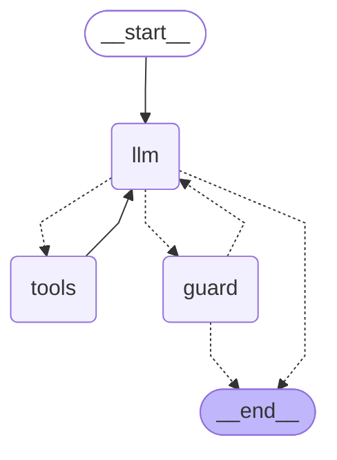

# Grafo do turno

Gerado por `build_graph(...).get_graph().draw_mermaid()` (Task 22). `llm` -> `tools` repete até `max_rounds` (4; 2 sob custo); `guard` volta a `llm` 1x (retry do guard).

Notas de projeto:
- O grafo é compilado uma vez (`build_graph()`); llm, ferramentas, prompt, prazo e limites do turno vão em `config["configurable"]["env"]`.
- A chamada do "resto" depois de um rascunho (REST_INSTRUCTION) mantém as ferramentas declaradas (decisão revisada): o LLM pode ainda chamar uma ferramenta para responder o resto da mensagem. Só a última rodada e o retry do guard vão sem ferramentas.
