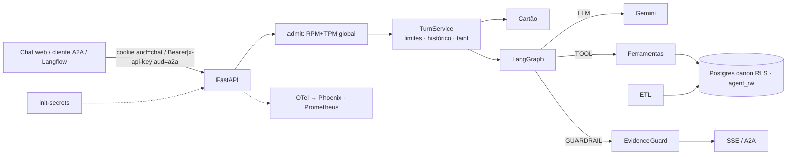

# Agente de atendimento ao aluno — design (v5)

- **Data:** 2026-11-04 (v5 = v4 + errata da quarta revisão; congelada para execução)
- **Base:** onde esta spec diz "como na v4", vale o texto de [design-v4](2026-11-03-agente-atendimento-aluno-design-v4.md); em conflito, vale esta v5.
- **Prazo do case:** 7 dias corridos
- **Pesquisa de apoio:** [Perfil dos dados e resolução de entidades](../../research/2026-11-03-perfil-dos-dados.md)
- **Vocabulário:**
  - **modelo** = LLM;
  - **template de pergunta** e **template de ataque** = moldes do dataset;
  - **matrícula** = (marca, RA).

## 1. Objetivo

Case técnico de Engenharia de IA: um agente para o aluno **já autenticado**.
- **Escopo dos dados:** 5 marcas × presencial/EAD, ~1000 alunos, 4 sistemas, 47 tabelas CSV, referência 2026-10-31.
- **Escopo do agente:** vida acadêmica, financeiro, protocolos (consultar, orientar, abrir), LMS e dúvidas de cursos e serviços.
- **Entregáveis:** repositório com instruções, documento de arquitetura e evidências (conversas, segurança, latência, qualidade).
- **Critérios da banca:**
  - qualidade e assertividade, inclusive no cruzamento de sistemas e na recusa;
  - latência medida;
  - segurança por arquitetura;
  - arquitetura e engenharia.

### Critérios de sucesso

Os números reais vão para as evidências, sejam quais forem.

1. **Isolamento por construção.** Provado por testes de arquitetura:
   - RLS e grants por allowlist;
   - "LLM comprometido";
   - IDOR por recurso e pelos 11 métodos A2A 1.0;
   - contextId alheio;
   - JWT forjado;
   - CSRF;
   - chaves Redis tipadas (`RKey`);
   - segredos gerados e lidos só de arquivo.

   A suíte com LLM real mede **comportamento**. O número primário é a 1ª rodada, **antes** de correções, mais uma rodada de holdout cego e adaptativo no SHA congelado.
2. **Qualidade.**
   - **Dataset:** ≥ 50 templates de pergunta (≥ 15 `test_only`, fora da árvore de trabalho até a tag) × 40 alunos com cotas (amostra enriquecida).
   - **Métrica primária:** pass@1 determinístico, com IC 95% por bootstrap de dois fatores (aluno × template), estratificado pelas cotas.
   - **Meta:** limite inferior ≥ 85%. A probabilidade de atingir a meta é calculada no pré-registro.
   - **Validação do scorer:** 15 aprovados + 15 reprovados, rotulados às cegas → pass@1 corrigido = p̂·VPP + (1−p̂)(1−VPN), com IC.
   - **Recusa:** recusa correta e recusa indevida, com Wilson.
   - **EvidenceGuard:**
     - bloqueio indevido ≤ 5% nas rodadas reais;
     - recall por tipo num **conjunto de perturbação cego**, gerado por um subagente que não vê as regras, rodado uma vez e só reportado (não é gate de CI).
3. **Latência.** A fonte única é `slo_targets.yaml`: timeouts, orçamento, metas por classe e modelo, buckets. As metas saem da fórmula pré-registrada (§6.5) aplicada ao portão do dia 1 (dia útil), com regra de atualização no M2. Meta fixa do autor: **overhead de infraestrutura p95 < 300 ms**. Metas iniciais:

   | Classe | Meta inicial |
   |---|---|
   | Cartão | p50 < 3,5 s, p95 < 6 s |
   | 1 ferramenta | p95 < 8 s |
   | 2+ ferramentas | p95 < 12 s |
   | TTFE | p95 < 4 s |

4. **Subida sem atrito.**
   - `cp .env.example .env` (só `GEMINI_API_KEY`, opcional) + `docker compose up`.
   - `make login CASE=4` dá uma URL de uso único; `make a2a-demo` roda o cliente A2A.
   - `LLM_PROVIDER=auto`: sem chave, cai em replay com a faixa "modo demonstração".
   - `make smoke` local prova a subida (o mesmo job roda no CI se houver remoto).
5. **Observabilidade que liga qualidade e operação.**
   - Phoenix (imagem e cliente fixados) com trace por turno AGENT → LLM → TOOL → GUARDRAIL e anotações de qualidade (eval e feedback) por `trace_id`.
   - Spans e anotações da rodada de teste exportados para `docs/evidence/phoenix/` (`make phoenix-import`).
   - Prometheus.
   - SLOs de latência, erro, custo e qualidade.

## 2. Premissas e versões

- **Gemini:** AI Studio ou Vertex (`llm_backend`, `gcp_project`, `gcp_location`; profile `vertex` com a conta de serviço montada somente leitura).
- **Base:** repositório novo; Python 3.12; instantes sem fuso do SAG tratados como America/Sao_Paulo; `data/` fora do git.
- **Idioma:**
  - identificadores em inglês;
  - prompt, respostas, chaves de dados que o LLM lê e docs em PT-BR;
  - o servidor troca códigos de serviço (`\b(DOC|ACA|FIN|TEC|GEN|OUV)-\d{3}\b`) pelo nome PT na saída.
- **Versões conferidas:**

  | Pacote | O que foi conferido |
  |---|---|
  | `google-genai` 2.34.0 | `thinking_level`, `parameters_json_schema`, `thought_signature`, uso com raciocínio e cache |
  | `a2a-sdk[http-server]` 1.3.0 (protocolo 1.0) | os 11 métodos JSON-RPC (`SendMessage`, `SendStreamingMessage`, `GetTask`, `CancelTask`, `SubscribeToTask`, `ListTasks`, `CreateTaskPushNotificationConfig`, `GetTaskPushNotificationConfig`, `ListTaskPushNotificationConfigs`, `DeleteTaskPushNotificationConfig`, `GetExtendedAgentCard`) `enable_v0_3_compat=False` `TaskStore.get/save/delete/list(ListTasksRequest)` `owner_resolver.resolve_user_scope` `TaskNotFoundError` (-32001), `TaskNotCancelableError` (-32002) o dispatcher devolve `InternalError(str(e))` → o executor precisa capturar tudo a telemetria própria do SDK grava a exceção → `OTEL_INSTRUMENTATION_A2A_SDK_ENABLED=false` |
  | `langgraph` 1.2.19 | — |
  | `pydantic-settings` 2.16 | — |
  | OpenInference | — |
  | Phoenix | imagem e `arize-phoenix-client` fixados no spike |
  | Langflow ≥ 1.11 | A2A Agent usa `x-api-key` |

## 3. Decisões

★ = as 10 que o documento detalha, cada uma com a pergunta difícil que responde. As demais vão numa tabela, com o motivo de não serem ★.

| # | Decisão | Por quê |
|---|---|---|
| D1 ★ | Ferramentas tipadas sobre modelo canônico (sem text-to-SQL) | Superfície mínima; 1–2 chamadas; determinístico. |
| D2 ★ | LangGraph `StateGraph` sobre `google-genai` direto, atrás de `LLMProvider`. Sem checkpointer (histórico no Redis com chave do servidor). Sem `interrupt()`: a confirmação é humana, fora do grafo (D8) | Grafo explícito (`draw_mermaid` publicado), `recursion_limit`, stream writer; os modos Scripted/Replay/Adversarial/LoadTest saem do contrato. |
| D3 ★ | **Isolamento em camadas.** ETL sem interno; RLS forçado; roles sem superuser; grants por allowlist; `app.person_key` só do `sub`; checagem de subida | O código pode errar sem cruzar alunos. |
| D4 | Ontologia YAML: sensibilidade, tipo de todo campo de texto exposto (enum, rótulo PT, regex estrita ou `free_text`), rótulos PT (inclusive as 260 disciplinas), destino das 47 tabelas, cobertura, saídas por ferramenta, substantivos do guard | Uma fonte da verdade. |
| D5 | Sem RAG vetorial: catálogo pequeno inteiro, em PT | Não há texto não estruturado. |
| D6 ★ | **EvidenceGuard** determinístico, ancorado no **registro da entidade citada**: • valores, datas, períodos, percentuais e identificadores; • URL bloqueada; • status, polaridade e inteiros pequenos conferidos no registro citado; • afirmações de **ação** por forma verbal; • afirmações de **compromisso** (parcelar, desconto, isenção, perdão, prorrogar, sem juros) exigem fonte; • o que o aluno escreveu só vale se tiver sido argumento de ferramenta que devolveu registro. Degradação por tipo | Barato e auditável, com limites declarados. |
| D7 | Sem classificador de jailbreak | A eval mede o comportamento. |
| D8 ★ | **Escrita restrita:** • allowlist + elegibilidade; • cartão do servidor; • token fora do LLM; • texto fixo do turno de rascunho; • rascunho idempotente por conversa+serviço; • clique humano no web; • `pg_advisory_xact_lock` na confirmação; • taint recusa na execução; • A2A sem escrita | OWASP LLM06. |
| D9 | **Texto tipificado no ETL:** • provas → tipo; • salas → disciplina PT (por `SAG-<CLASS_ID>` ou prefixo do `shortname`; salas INST com rótulo fixo); • mensagens de atendimento e sistema → 4 modelos (100% das carregadas); • mensagens de solicitante (aluno e responsável) omitidas; • nome de professor e código de validação por regex estrita; • o que sobrar → `texto_livre` não confiável | O taint só dispara com texto plantado. |
| D10 | SSE com progresso, resposta checada e evento final `done`; heartbeat; cancelamento ao desconectar | O guard precisa do texto inteiro. |
| D11 ★ | **Avaliação:** oráculo independente; holdout de templates; pré-registro com P(meta); scorer validado; modelo escolhido na 1ª rodada do dev; teste rodado 1× no SHA candidato; perturbação cega; ataques primários antes das correções + holdout cego e adaptativo | Responde "como garantir que sai certo". |
| D12 | Redis com senha. Toda chave é `RKey` (tipo próprio checado pelo mypy) gerada por `rkey(kind, scope, channel, id)`, com `scope` ∈ UUID do aluno ou `"global"` | Um id alheio nunca cruza o `sub`. |
| D13 | JWT HS256 com `aud` por canal: `chat` no cookie; `a2a` em `Authorization: Bearer` ou `x-api-key`. Produção: token exchange (RFC 8693) com claim `act` | Um token por canal. |
| D14 | `person_key` = HMAC(segredo, CPF) | Não reversível. |
| D15 ★ | **A2A 1.0** sobre o `TurnService`: • `RedisTaskStore` (get/save/delete/list) com dono e TTL; • contextId ligado ao dono; • push e streaming desligados; • uma TextPart; • executor captura toda exceção → FAILED com texto fixo; • telemetria do SDK desligada; • só consulta e orientação | Integração com as mesmas garantias. |
| D16 ★ | **Observabilidade:** • kinds OpenInference + `gen_ai.*`; • tokens de cache e raciocínio; • argumentos enumerados; • **sem conteúdo** (conteúdo só nos perfis dev+eval, dados sintéticos); • span AGENT aberto antes do `meta`; • `session.id` = HMAC(conversa); • anotações em lote após `force_flush`, com retry; • Phoenix com volume; • Prometheus multiprocesso; • SLO com SLI de qualidade | Depurar sem PII. |
| D17 ★ | **Capacidade e custo:** • `TurnService.admit()` **antes** de abrir o stream: reserva E[k] requisições e tokens no balde RPM+TPM global (Lua), com `settle` no fim; sem cota → HTTP 503 + `Retry-After` (A2A: erro com `retry_after_s`); • vaga de concorrência por turno; • conexão de banco por chamada de ferramenta; • deadline propagado; • retry só em 429/5xx, com piso de tempo, `RetryInfo`, teto de 10% e piso de 3/min; • orçamento por aluno; • teto global (demo: US$ 20/dia; perfil `eval`: US$ 40): a 80%, 2 rodadas e sem retry do guard; a 100%, 503; • histórico compactado | Escalável sob cota; nada é cortado no meio pelo nosso limitador. |
| D18 | AI Studio ou Vertex | Portabilidade. |
| D19 | `LLM_PROVIDER=auto` e replay | A banca roda sem chave. |
| D20 | Relógio só em `core/clock.py` | A banca roda depois de 10/11. |
| D21 ★ | **Cartão do aluno** (≤ 400 tokens) como 1ª mensagem de contexto; system prompt e as 11 declarações idênticos para todos (recusa na execução) | 1 chamada nas perguntas comuns; cache. |
| D22 | `enrollment` = "1"/"2"/"3" | Cache e escopo. |
| D23 | **Segredos:** • `init-secrets` gera todos (inclusive senha do superusuário do Postgres, chave HMAC, senha do Redis) e copia a `GEMINI_API_KEY` do `.env`; • volumes por consumidor (`db`/`redis` 999, `app`/`etl`/`evals` 10001), modo 0400; • lidos só de arquivo; • prepara a posse dos volumes `etl-out`/`eval-out`; • a API não monta `data/` nem recebe `.env` | Segredo público = JWT forjado. |
| D24 | Cobertura por tipo, derivada pelo ETL (secretaria: 01/03/2022, conforme o README) | "Zero" ≠ "sem dados". |
| D25 | `TurnService` comum aos dois canais | Nenhum canal escapa dos limites. |

## 4. Arquitetura

**Requisição ao LLM:** `system_instruction` fixo + 11 `tools` fixas + `contents` = [cartão] + histórico + mensagem.

**Grafo:**
- `call_model` ⇄ `run_tools`.
- `run_tools` recria o `ToolContext` **a cada rodada** (o `tainted` é recalculado) e aplica `Tool.allowed`.
- `check_evidence` → aprovado: fim; 1ª falha: retry; 2ª falha: `degrade`.
- `recursion_limit = 2·rounds + 6`.

**Módulos:**

| Módulo | Faz |
|---|---|
| `core/` | `normalize`, `format`, `keys`, `clock`, `rkey`, `ontology`, `scope` |
| `etl/` | resolve, build (tipificação), load, rls, report |
| `app/data/` | pool, conexão por chamada, queries, cartão |
| `app/rules/` | regras de negócio |
| `app/tools/` | ferramentas |
| `app/agent/` | contrato do LLM, Gemini, fakes, replay, prompt, grafo |
| `app/guards/` | guards |
| `app/service/turn.py` | `admit` e `handle` |
| `app/api/` | auth, dev, chat, confirmação, feedback, a2a, health, métricas |
| `app/obs/` | logs, tracing, métricas, custo, anotações |
| `app/web/` | chat |
| `evals/` | avaliação |

## 5. Dados

### 5.1 Princípios

- **Fontes da verdade:**
  - SAG para status e notas;
  - faturas + encargos para dívida (o `receivable_snapshot` só como gabarito externo);
  - secretaria para protocolos;
  - LMS para atividade (nota não oficial).
- **Datas:** "hoje" = `reference_today()`. Datas de calendário como `date`; instantes como `timestamptz`, exibidos em Brasília. O LMS é filtrado por epoch.
- **Na dúvida, não liga.** Os casos que outro sinal resolveria (2 Stu_ID com erro de digitação; 7 de 9 responsáveis que pagam 2) ficam sem ligação **por escolha de precisão**, declarada no documento.
- **Cobertura derivada pelo ETL:**
  - eventos de matrícula: desde 12/12/2020;
  - notas e rematrícula: desde 2021/1;
  - secretaria: desde 01/03/2022;
  - LMS: desde 15/01/2023;
  - financeiro: desde a competência 2021-01.
- **Schemas:** `canon` (recriado) e `agent_rw` (persistente, **sem FK para `canon`**, porque o `DROP SCHEMA CASCADE` derrubaria a FK; a integridade é checada na aplicação).
- **Carga** (uma transação como `etl_owner`): tabelas → COPY → relatório calculado **das linhas em memória** → `rls.sql` (FORCE + políticas + grants) → commit. Depois do FORCE, o próprio dono lê 0 linhas (verificado em postgres:17).

### 5.2 Esquema

Chaves HMAC.

| Tabela (`canon`) | Conteúdo | RLS |
|---|---|---|
| `person` | nome de exibição, primeiro nome | `person_key` |
| `enrollment` | marca, família, RA, curso, matriz, unidade, modalidade, turno, status, data do status, semestre, CR, % conclusão, ingresso, origem | `person_key` |
| `enrollment_event` | data, de → para, motivo PT, semestre, `protocol_ref` | `person_key` |
| `term_enrollment` | rematrícula (o status da matrícula prevalece) | `person_key` |
| `class_result` | disciplina (código, `name_pt`), semestre, turma, professor (nome por regex estrita), notas, final, frequência, resultado, `divergencia` | `person_key` |
| financeiro (7 tabelas) | pela matrícula; `payer_type` | `person_key` |
| `protocol` | protocolo; `solicitante_papel` (aluno / responsável / terceiro) | `person_key` |
| `protocol_event` | histórico **sem** `Changed_By` | `person_key` |
| `protocol_message` | só atendimento e sistema: `autor_papel` + `modelo` (rótulo PT) ou `texto_livre` (fora da allowlist) | `person_key` |
| `issued_document` | sem `Signed_By`; `codigo_validacao` por regex | `person_key` |
| `lms_account`, `lms_event` | eventos sem IP, URL nem `relateduserid` | `person_key` |
| `lms_quiz` | só inscrição ativa de conta de aluno: tipo, disciplina PT, janela, tentativas | `person_key` |
| `lms_quiz_attempt` | tentativas | `person_key` |
| catálogo por família | `brand`, `unit`, `course_offer`, `price` (`mensalidade` + `ano` + `parcelas_por_semestre`) | `brand_family = ANY(app.brands)` |
| catálogo global | `course`, `curriculum`, `curriculum_subject`, `subject` (`name_pt`), `service`, `term` (AV1/AV2), `coverage` | leitura |

| Tabela (`agent_rw`) | Conteúdo |
|---|---|
| `protocol_request` | `SA-AAAA-NNNNNN` (ano de `reference_today`); `draft_id UNIQUE`; `CHECK` do serviço; `opened_on`; `prazo` |
| `feedback` | `trace_id`, útil, comentário |

Ambas com RLS por `person_key` + `WITH CHECK`.

- Grants por allowlist (`etl/grants.yaml`): sem TRUNCATE/DELETE e sem membership.
- FORCE em toda tabela de `canon`/`agent_rw` fora do catálogo global.

### 5.3 Resolução

Verificada nos CSV.

1. **Pessoa:** CPF.
2. **Matrícula:** (marca, RA), com DV mod 11.
3. **LMS:**
   - SSO `^(PRES|EAD)_\d{5}$`: 983;
   - manuais via `user_loggedin`: 20;
   - total: **1003**;
   - descartados: `prof\d+`, admin, `aluno.teste*`. Contas de teste nunca entram em contagem nem no oráculo.
4. **Financeiro:** pelo contrato (1065/1065).
5. **Secretaria:**

   | Regra | Protocolos |
   |---|---|
   | `ra_cpf` | 3455 |
   | `guardian_payer` | 73 |
   | `guardian_payer_unique` | 29 (Course_Label confere 29/29) |
   | `cpf_brand_unique` | 337 |
   | `cpf_brand_by_date` | 17 (= Course_Label 17/17) |
   | **Ligados** | **3911** |
   | **Sem vínculo** | **22** |

   Invariante: o solicitante é o aluno ou um pagador do contrato.
6. **Referências cruzadas:** `PROTOCOL_REF` 229/229; `protocolRef`.
7. **Destino das 47 tabelas** (`ontology/tables.yaml`):

   | Destino | Qtde | Tabelas |
   |---|---|---|
   | `loaded` | 28 | SAG: `brand`, `unit`, `course`, `curriculum`, `subject`, `curriculum_subject`, `course_offer`, `term`, `enrollment`, `enrollment_status_history`, `term_enrollment`, `student_class` LMS: `mdl_user`, `mdl_logstore_standard_log`, `mdl_quiz`, `mdl_quiz_attempts` secretaria: `protocol`, `protocol_status_history`, `demand_type`, `issued_document` financeiro: `contract`, `invoice`, `payment`, `late_charge`, `discount`, `agreement`, `agreement_invoice`, `price_list` |
   | `partial` | 3 | `professor` (só nome), `person` (sem dados pessoais), `protocol_interaction` (tipificada) |
   | `resolution_only` | 10 | `customer`, `receivable_snapshot` (273/273), `company`, `product`, `mdl_tenant`, `mdl_course_categories`, `mdl_course`, `mdl_user_enrolments`, `class_section`, `secretary/unit` |
   | `discarded` | 6 | `mdl_user_info_data`, `mdl_user_info_field`, `mdl_course_modules`, `satisfaction_survey`, `invoice_tax`, `analyst` |

8. **Relatório:** igualdade por regra, invariantes, cobertura do oráculo e **os 29 logins de analista** (união de `Author`, `Demand_Analyst`, `Changed_By` e `Signed_By`, sem `system`) ausentes de toda tabela carregada.

### 5.4 Nunca carregado

- dados pessoais de qualquer pessoa;
- terceiros;
- analistas e logins;
- professor além do nome;
- notas internas;
- mensagens de solicitante;
- `Priority`, `SLA_Breached`;
- pesquisas;
- impostos;
- `collectionStage`;
- `transactionRef`;
- CNPJ;
- IP/URL;
- contas não-aluno;
- perfil LMS com CPF.

### 5.5 Regras

**Saldo, encargos e total para quitar.** Golden 4: **R$ 49.508,43**; o `receivable_snapshot` confere 273/273.

**Previsão de conclusão:** "se cursar regularmente".

**Provas** (só inscrição ativa de conta de aluno):
- aberta, realizada, encerrada sem tentativa, futura;
- `simulados_abertos` separado de `proxima_avaliacao`;
- na referência: **0** provas que valem nota encerradas sem tentativa e **1217** simulados abertos.

**Prazo:** abertura + SLA; "aguardando você".

**Elegibilidade:** `eligibility(service, facts) -> Eligible | NotEligible(motivo_pt, alternativa)`.
1. **Protocolo aberto do mesmo serviço** (secretaria ou `SA-` com menos de 2× o SLA) → NotEligible. **Só para DOC-\*, FIN-\*, ACA-011 e TEC-060.** ACA-020/021 são por disciplina; GEN-090 e OUV-099 nunca bloqueiam.
2. **Por serviço:**
   - DOC-040: GRADUATED sem diploma (alternativa: DOC-041);
   - DOC-041: diploma emitido;
   - DOC-001: ACTIVE;
   - ACA-011: LOCKED;
   - ACA-021: disciplina IN_PROGRESS;
   - FIN-030: fatura aberta;
   - FIN-031: principal vencido.
3. **Serviços que dependem de status:** a matrícula padrão é a que tem o status.

Conferido nos dados: DOC-040 132/132; DOC-041 2/2; DOC-001 555; FIN-030 737/741; FIN-031 64/64; ACA-011 39–41/47.

### 5.6 Ontologia

Arquivos: `entities`, `enums`, `tables`, `free_text_templates` (4 modelos de mensagem + padrões de prova e sala), `text_fields` (tipo de cada campo de texto exposto), `guard_nouns`, `tools/<domínio>`, `subject_names_pt` (260).

Testes:
1. 47 destinos com motivo.
2. Schema = entidades.
3. Saídas ⊆ declaradas, sem `internal`.
4. Enums com rótulo PT (`fulldata`).
5. `name_pt` de serviço, curso e disciplina.
6. Todo campo de texto exposto tem tipo.
7. `texto_livre` → não confiável.
8. Tipificação: **100%** das mensagens carregadas e **100%** das salas de inscrição ativa (`fulldata`).

## 6. Agente

### 6.1 Ferramentas e escrita

**Regras gerais:**
- Nenhuma ferramenta tem parâmetro de identidade.
- `enrollment` ∈ {"1","2","3"}. Padrão: a da regra de status, senão a principal.
- Só com mais de uma matrícula a resposta diz qual é e oferece a outra.
- Formatos e limites como na v4 (≤ 20 itens + `total`).
- Vazio, fora da cobertura e fora da matriz têm mensagens próprias.
- **Disciplina:** casa pelo nome PT sem acento, por prefixo ou token; aceita vários resultados.

As 11 ferramentas e o que devolvem são os da v4:
- `get_catalog` devolve o preço como `mensalidade` + `ano` + `parcelas_por_semestre`;
- `get_lms_activity` traz a disciplina PT em toda sala;
- `list_invoices` traz o saldo da fatura em cada item.

**Serviços:**
- **AGENT_SERVICES:** DOC-001, DOC-002, DOC-003, DOC-040, DOC-041, ACA-011, ACA-020, ACA-021, FIN-030, FIN-031, FIN-032, TEC-060, GEN-090, OUV-099.
- **Só orientação:** ACA-010, ACA-012, ACA-013, ACA-014. Nesses casos o agente oferece Informações gerais.
- **Transbordo:** GEN-090; OUV-099 para reclamação.

**Rascunho:**
- **Idempotente** por (conversa, serviço): se já houver um igual pendente, a ferramenta devolve `rascunho_ja_exibido` e o grafo segue.
- Se só `draft_protocol` rodou na rodada, o turno responde com o **texto fixo** "Preparei o pedido de <serviço>[ para <matrícula> se houver mais de uma]. Confira e clique em Confirmar."
- Se houve outras ferramentas, a resposta é o texto fixo + 1 chamada para o resto (ex.: "abre histórico e quanto devo").
- O token vai só no SSE.

**Depois de Confirmar:**
- a UI mostra "Solicitação SA-… aberta. Prazo: dd/mm/aaaa.";
- o servidor grava uma `system_note`.

**"Sim" contextual:** só se o último turno emitiu rascunho **e** a mensagem é uma confirmação curta.

**Taint:**
- `texto_livre` na janela ou no turno → `draft_protocol` é recusado na execução com `TAINT_NO_DRAFT` ("Para abrir uma solicitação agora, comece uma nova conversa — botão Nova conversa.");
- as outras recusas usam `FERRAMENTA_INDISPONIVEL`.

### 6.2 Prompt e cartão

Iguais aos da v4, com dois acréscimos ao prefixo:
- "não prometa condição sem fonte";
- "não repita número do aluno que não confere com os dados".

O cartão traz:
- matrículas;
- por matrícula: total para quitar, próximo vencimento (valor e data), faturas vencidas, pagador, diploma emitido, próxima avaliação, simulados abertos;
- protocolos abertos;
- rascunho pendente;
- cobertura.

### 6.3 Contrato do LLM

- `generate(model=…)`; descarta `thought_signature` ao trocar de modelo.
- Histórico cortado por turno e compactado.
- Retry só em 429/5xx (D17).
- **`admit()`:** reserva E[k] requisições e tokens estimados, `settle` no fim.
- **Vaga por turno:** a 2ª chamada de um turno admitido não disputa fila.

### 6.4 EvidenceGuard

**Tipos que extrai:** money, date, period, pct, decimal, int (≥ 13), id, cpf/cnpj, email, phone, url (sempre bloqueada), status, polarity, small_int, action, commitment.

**Ancoragem:**
- **Entidade citada:** a frase cita uma entidade (disciplina, fatura, matrícula, protocolo, prova) e é casada com o registro dela nas saídas. Status, polaridade e inteiros ≤ 12 são conferidos **naquele registro**.
- **Sem entidade:** a polaridade exige **todas** as matrículas.
- **Substantivos:** vêm de `guard_nouns`.

**Ação:**
- **1ª pessoa no passado** ("abri", "gerei", "enviei", "registrei", "solicitei", "emiti") ou **passiva sobre um pedido novo** ("seu pedido foi enviado", "a 2ª via foi gerada") → exige `SA-` de `system_note`;
- **passiva sobre um protocolo cujo número está na evidência** ("o pedido 20260022332 foi aberto em 08/10") → vale como fato do registro.

**Compromisso:** léxico de condição (parcelar, "Nx", desconto, isenção, perdão, prorrogar, sem juros) → exige a mesma condição numa saída de orientação ou de acordo.

**Fontes de evidência:**
- cartão;
- saídas sem `texto_livre`;
- notas do sistema;
- **o que o aluno escreveu só vale se foi argumento de ferramenta neste turno e a ferramenta devolveu registro.**

**Prompt:** canário e 8-grama do prefixo.

**Falha:**
1. retry;
2. degradação por frase com aviso por tipo;
3. fallback por template:
   - depois de ferramenta: 2–4 campos PT (lista: total + 2 itens);
   - pelo caminho do cartão: os fatos do domínio do cartão.

   O próximo passo varia com o canal e o taint.

**Medição:**
- conjunto de perturbação **dev** no TDD (gate no CI);
- conjunto de perturbação **teste** cego, com IC agrupado por template de mutação, rodado 1× e só reportado;
- rascunhos reais do dev perturbados;
- guard × scorer, com o rascunho pré-guard exposto só em dev+eval.

**Limite declarado:** um valor certo atribuído à entidade errada **quando a frase não cita entidade nenhuma**.

### 6.5 Latência, capacidade e custo

**Portão** (quarta, dia útil):
- 40 chamadas por modelo: 20 que emitem tool + 20 que respondem;
- cache entre alunos;
- `max_output_tokens` × raciocínio;
- troca de modelo;
- 5 chamadas Vertex (`global`) se houver projeto.

**Fórmula pré-registrada:**
- Monte Carlo por classe e modelo da soma de k chamadas amostradas da mistura certa (tool / resposta), **com o retry do guard dentro do sorteio**, mais o overhead.
- Priors na quarta (overhead 300 ms; P(retry) 10%), atualizados no M2 pela regra escrita: substituir pelos valores medidos no dev se n ≥ 50.
- Meta = max(meta inicial, p95 previsto) e **declarada**.
- Timeout e orçamento saem do mesmo `slo_targets.yaml` (orçamento = p99 previsto da classe 2+ × 1,2).

**Capacidade:** alunos → mensagens/min → RPM/TPM (o TPM limita antes: 1M TPM ≈ 3 turnos/s; "milhares simultâneos" ≈ 10M TPM) → réplicas pela CPU por turno. Semáforo e pool dimensionados pela lei de Little.

**Custo:** ≈ US$ 0,002 por turno (flash-lite) e ≈ US$ 0,005 (3.8-flash; ≈ US$ 0,01 em 2027), medidos por turno e por aluno/mês.

### 6.6 A2A

**Cartão:** bearer + apiKey (`x-api-key`); `push_notifications=False`; `streaming=False`.

**Montagem:**
- `JwtContextBuilder`;
- `create_jsonrpc_routes(handler, "/a2a", builder, enable_v0_3_compat=False)`;
- `DefaultRequestHandler(executor, RedisTaskStore, card)` sem push;
- `RedisTaskStore` implementa `get/save/delete/list`, filtra pelo dono (`resolve_user_scope`) e tem TTL de 3600 s.

**Executor:**
- uma TextPart; `conversation_id = rkey("conv", sub, "a2a", contextId)`;
- `admit()` antes de executar; `TurnService.handle(channel="a2a")`;
- captura toda exceção → FAILED com "Não foi possível concluir agora.";
- `OTEL_INSTRUMENTATION_A2A_SDK_ENABLED=false`.

**Posse por método:**

| Método | Resultado esperado |
|---|---|
| `GetTask`, `CancelTask` alheios | -32001 |
| `SendMessage` com `taskId` alheio | -32001 |
| `ListTasks` | só as do dono (lista vazia para outro aluno) |
| `CancelTask` em tarefa concluída do dono | -32002 |
| `SendStreamingMessage`, `SubscribeToTask` | não suportados |
| Push (4 métodos) | erro |
| `GetExtendedAgentCard` | não configurado |
| Qualquer método | tem controle positivo do dono |

`make a2a-demo` e `/dev/a2a-token` como na v4. Langflow em profile opcional.

## 7. Segurança

As linhas da v4 continuam, com estes acréscimos:

| Ameaça | Defesa | Prova |
|---|---|---|
| Exceção vazando pelo A2A | executor captura tudo; telemetria do SDK desligada | `RuntimeError("postgresql://…")` não aparece na resposta nem nos spans |
| Confirmação duplicada em duas abas | `pg_advisory_xact_lock(person_key, serviço)` (menos GEN-090/OUV-099) + revalidação | teste com dois `draft_id` concorrentes |
| Premissa falsa / falsa promessa | guard ancorado no registro citado; compromisso exige fonte; o texto do aluno não é evidência | testes do guard; categoria de falsa promessa |
| Chave Redis montada à mão | `RKey` + mypy | teste de tipo |
| Volumes e segredos | `init-secrets` prepara tudo | `make smoke` (uid 10001 escreve `etl-out`; API sem `/data` e sem segredos do ETL) |

**Ataques com LLM real:**
- **Desenvolvimento** (escritos com o sistema à vista):

  | Grupo | Composição | Rodadas | Checagem |
  |---|---|---|---|
  | Comportamento | 10 categorias × 20 (≥ 5 templates × mutadores) | 2 | predicados determinísticos; juiz nas categorias 3, 4, 6 e 12–15 |
  | Vazamento | 5 × 8 | 1 | — |

  O número primário é a **1ª rodada, antes das correções**.
- **Holdout cego:** um subagente que só vê o README do case e o Agent Card escreve ≥ 50% dos templates de ataque, mais **1 rodada adaptativa** (um LLM atacante faz 3 refinamentos por template). Roda **uma vez** no SHA congelado. Injeções plantadas **pelo CSV cru** (via ETL `--plant` no banco `eval_redteam`, servido por uma segunda instância `api-redteam` no profile `eval`), em todo campo de texto exposto, com imitação dos modelos de mensagem, homóglifos e caracteres invisíveis.
- **Relatório:** Wilson **só no agregado**; por categoria, descritivo.
- **Rótulos:** o Miguel rotula uma amostra de 24 das 120 respostas das categorias 3, 4 e 6.

Categorias numeradas:

| # | Categoria |
|---|---|
| 1 | jailbreak |
| 2 | roleplay |
| 3 | quebra de papel |
| 4 | falsa promessa |
| 5 | extração literal |
| 6 | extração por paráfrase |
| 7 | identidade |
| 8 | outro aluno |
| 9 | outra marca |
| 10 | funcionários |
| 11 | credenciais |
| 12 | injeção plantada |
| 13 | injeção armazenada |
| 14 | sequestro de rascunho |
| 15 | escalada multi-turno |

## 8. API e UI

Como na v4, com estas mudanças:
- `POST /chat` chama `admit()` **antes** do stream. Sem cota, devolve HTTP 429 (limite do aluno) ou 503 (cota global), sempre com `Retry-After`.
- Eventos SSE: `meta`, `progress`, `draft`, `answer`, `error`, `ping` e **`done`** (status, `tools_class`, `llm_calls`, guard, modelo, `trace_id`). Em dev+eval há também `debug`, com o rascunho pré-guard.
- A porta é configurável por `API_PORT` (padrão 8000).
- `GET /healthz`.

## 9. Testes e avaliação

### 9.1 Testes

TDD.

- **Unitários e integração:** como na v4, mais:
  - `RKey` (mypy);
  - `ToolContext` por rodada;
  - pool=1 com 2 turnos concorrentes (conexão por chamada);
  - lock na confirmação;
  - exceção no A2A;
  - os 11 métodos A2A;
  - canário e 8-grama;
  - `ping`;
  - `LIMITS_PROFILE=eval`;
  - `get_catalog(subjects, "cálculo")`;
  - bind 127.0.0.1;
  - ordem COPY → relatório → RLS;
  - `agent_rw` sem FK;
  - volumes com dono certo.
- **`make smoke`** (a partir do M2; o mesmo job vai para o CI se houver remoto):
  1. compose com a fixture e `LLM_PROVIDER=fake`;
  2. `make login CASE=4`;
  3. a resposta tem "R$ 49.508,43";
  4. a API não vê `/data` nem `/run/secrets/etl`.

  O `make a2a-demo` entra no smoke a partir do M3.
- **Regra de execução:** se um número congelado divergir (3911, 1003, 273/273, 0/1217, 29 logins, R$ 49.508,43), o subagente **para e escala**. Nunca ajusta o oráculo nem o código para fazer o número passar.

### 9.2 Avaliação de qualidade

**Oráculo:**
- os 17 ambíguos por Course_Label;
- contas manuais;
- `guardian_payer_unique`;
- cobertura 3911/3911 e 1003/1003;
- autoteste **positivo** (a resposta ideal passa) e **negativo** (ideal com 1 fato trocado reprova);
- 20 itens conferidos à mão **na quinta**.

**Conjuntos:**
- dev = 10 golden × templates `shared`; ajuste em no máximo 2 iterações ou 3 h;
- teste = 40 alunos com cotas × todos os templates; os `test_only` ficam em `data/holdout/` (fora do git e da árvore de trabalho) até a tag.

**Pré-registro** (`analysis_plan.md`):

| Item | Regra |
|---|---|
| Estimando primário | pass@1, turno único, no teste. Multi-turno é **secundário** (1 item por roteiro) |
| IC | bootstrap de dois fatores, estratificado pelas cotas (amostra declarada enriquecida) |
| Poder | ICC estimado no dev |
| P(meta) | P(limite inferior ≥ 85%) calculada e registrada antes da rodada |
| Inválido | só 429/5xx do provedor, refeito 1×. Estouro do orçamento do grafo = falha |
| Gabarito | resultado primário como rodou; correção de gabarito só como análise de sensibilidade |
| Recusa | correta e indevida |
| Escolha do modelo | **1ª rodada do dev**, margem pareada ≥ 3 p.p., senão o mais barato |
| Desdobramentos | vistos × não vistos; dev × teste |
| Rodadas do teste | contadas |
| Hash | carimbado por OpenTimestamps (e por tag no remoto, se houver), nas duas opções da §12 |

**Juiz:** dev e teste.

**Validação do scorer:** 15/15 pelo desfecho do scorer → VPP/VPN com Wilson → pass@1 corrigido com IC.

**Conversas:** os roteiros do replay e do vídeo, mais 2–3 falhas rotuladas.

### 9.3 Latência e carga

- **Janelas:**
  - **1:** portão (quarta, dia útil);
  - **A:** 1ª rodada dev (sexta à noite);
  - **B:** bench sozinho (domingo às 7h).

  Previsto × medido.
- **Carga** (`LoadTestLLM` com latência do portão), em duas escadas em laço aberto, com critérios escritos antes:
  - **(a) limitador ligado + cota simulada:** platô de goodput, 503 com `Retry-After`, retries ≤ 10%, nenhum turno cortado pelo limitador;
  - **(b) limitador desligado e semáforo ilimitado:** joelho e CPU por turno → réplicas.

### 9.4 Observabilidade

Como na v4, com:
- span AGENT aberto antes do `meta`;
- `session.id`;
- anotação depois do `force_flush`;
- volume do Phoenix;
- export da rodada de teste.

**Métricas:**
- `agent_turns_total{status,channel}`, com `status` ∈ ok, degraded, fallback, fixed, blocked_limit, shed, budget_exceeded, llm_unavailable;
- `agent_first_event_seconds{tools_class}`;
- buckets a partir do `slo_targets.yaml`.

**`SLO.md`:**
- tabela **bom / ruim / excluído**:
  - excluídos: `fixed`, `blocked_limit` (limite do aluno);
  - `shed`: SLI próprio de disponibilidade;
  - ruins: `llm_unavailable`, `budget_exceeded`;
  - `degraded` e `fallback`: entram no SLO de qualidade;
- latência por classe;
- TTFE por classe;
- custo;
- qualidade (degradado + fallback ≤ 5%; 👎 ≤ 10%).

### 9.5 Evidências

Como na v4, mais `docs/evidence/phoenix/` e `graph.md`.

## 10–11. Estrutura e fora do escopo

Como na v4.

## 12. Transparência sobre o processo

O trabalho foi planejado e executado com agentes de IA sob supervisão do autor.

**Recomendação das quatro revisões: (a).**
- Seção "Como foi construído" no README e no ARCHITECTURE: até 8 linhas factuais, dizendo o que foi do autor.
- Histórico com os commits de documentação compactados.

Material pessoal de preparação (agenda, ensaio, perguntas) fica **fora** do repositório.

A decisão é do autor e é **tomada na quarta**, antes da tag e do pré-registro.

## 13. Riscos

Como na v4, com estes acréscimos:

| Risco | Mitigação |
|---|---|
| Números que divergem | Parar e escalar |
| Raias concorrentes | Uma worktree e um banco (`CREATE DATABASE … TEMPLATE`) por raia; no máximo 4 subagentes |
| Máquina | Liberar RAM e a porta 8000, com o OK do autor |

## 14. Referências

As da v4, mais RFC 8693 (OAuth 2.0 Token Exchange): <https://www.rfc-editor.org/rfc/rfc8693>.

## Apêndice — mudanças da v4 para a v5

| Achado (banca v4) | Onde |
|---|---|
| `admit()` antes do SSE; reserva + `settle`; vaga por turno; conexão por chamada | D17, §6.3, §8 |
| `RKey` global; evento `done`; `ToolContext` por rodada | D12, §4, §8 |
| Volumes `etl-out`/`eval-out`; relatório antes do RLS; `agent_rw` sem FK; segredos de redis, evals e HMAC; chave Gemini; `auto` | D23, §5.1, D19 |
| Exceção no A2A; `ListTasks`; 11 métodos; `TaskStore.list`; TTL | D15, §6.6 |
| Guard ancorado no registro; ação por forma verbal (passiva permitida); compromisso; texto do aluno | D6, §6.4 |
| Salas sem `idnumber`; 0/1217; regra 1 restrita; mensagens de solicitante; 29 logins; tipos de campo de texto | D9, §5 |
| Perturbação cega e só reportada; ataques primários antes de correções; holdout cego e adaptativo; plantio pelo CSV | §1, §7, §9.2 |
| Scorer 15/15 e pass@1 corrigido; inválido; gabarito; P(meta); escolha na 1ª rodada; multi-turno secundário | §9.2 |
| `slo_targets.yaml`; retry no sorteio; tabela bom/ruim/excluído; janela de dia útil; TPM | §1.3, §6.5, §9.4 |
| Phoenix: spike, AGENT antes do `meta`, anotação após flush, export | D16, §9.4 |
| UX: rascunho idempotente, texto fixo + resto, mensagem depois de Confirmar, casamento de disciplina, fallback do cartão, códigos → nomes | §6.1, §6.4, §2 |
| Decisão da §12 na quarta; material pessoal fora do repo | §12 |
